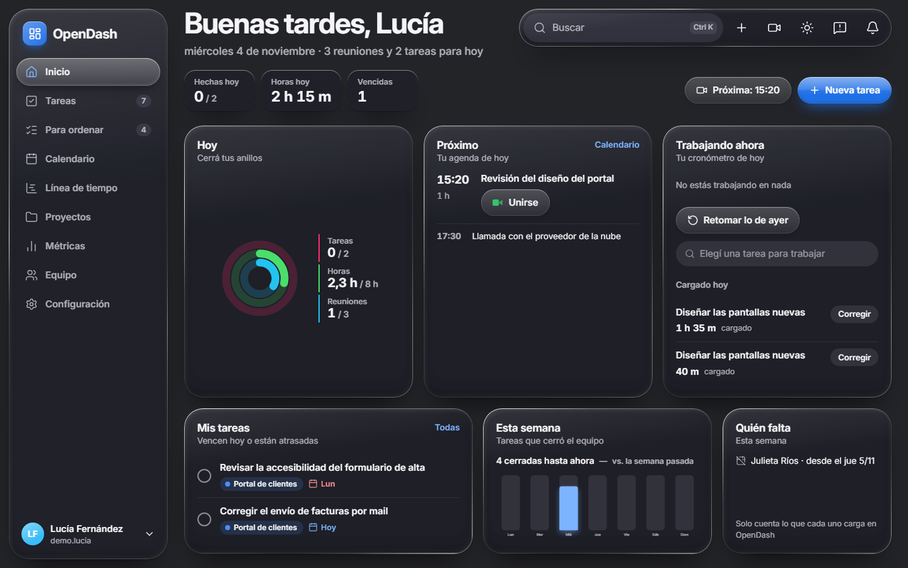
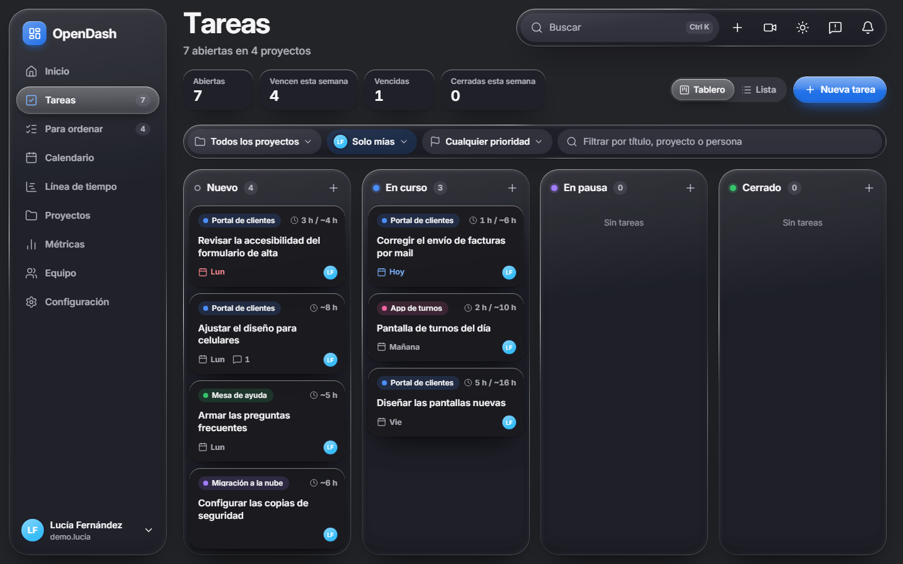
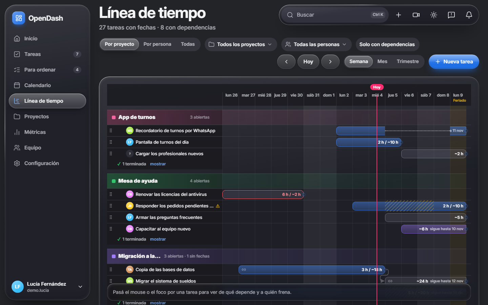
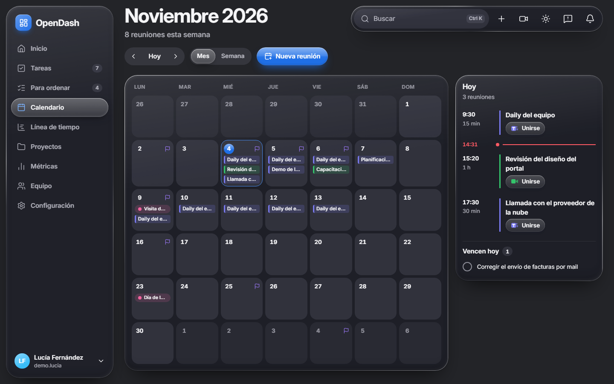
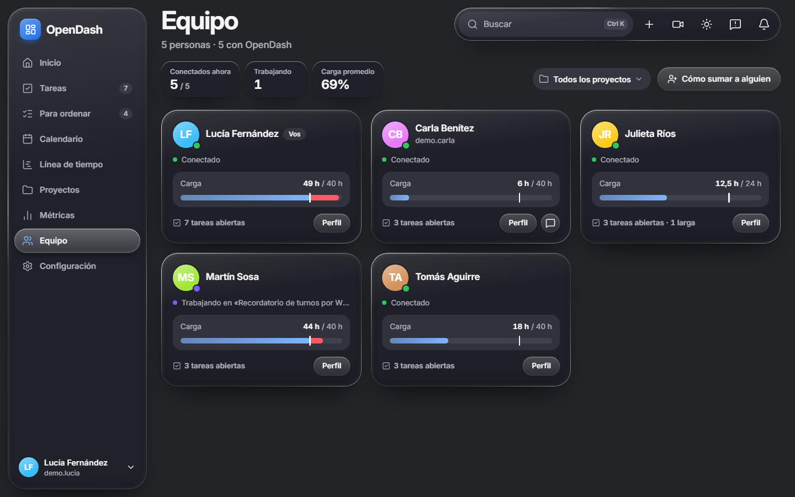
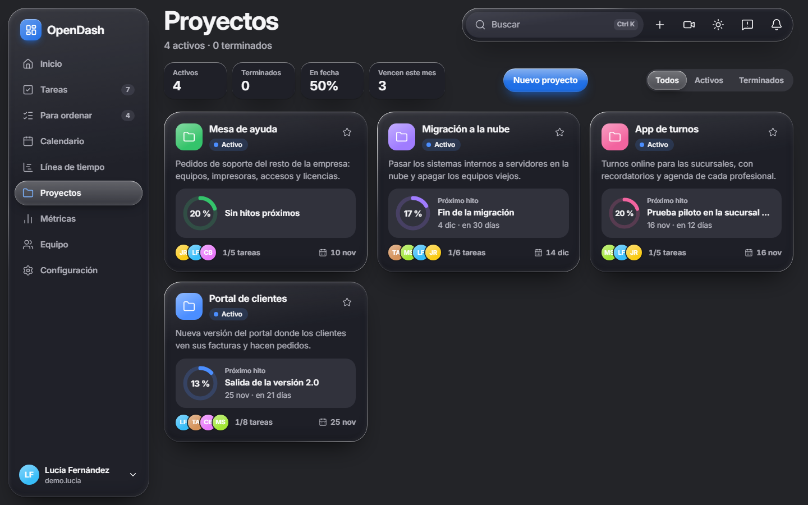
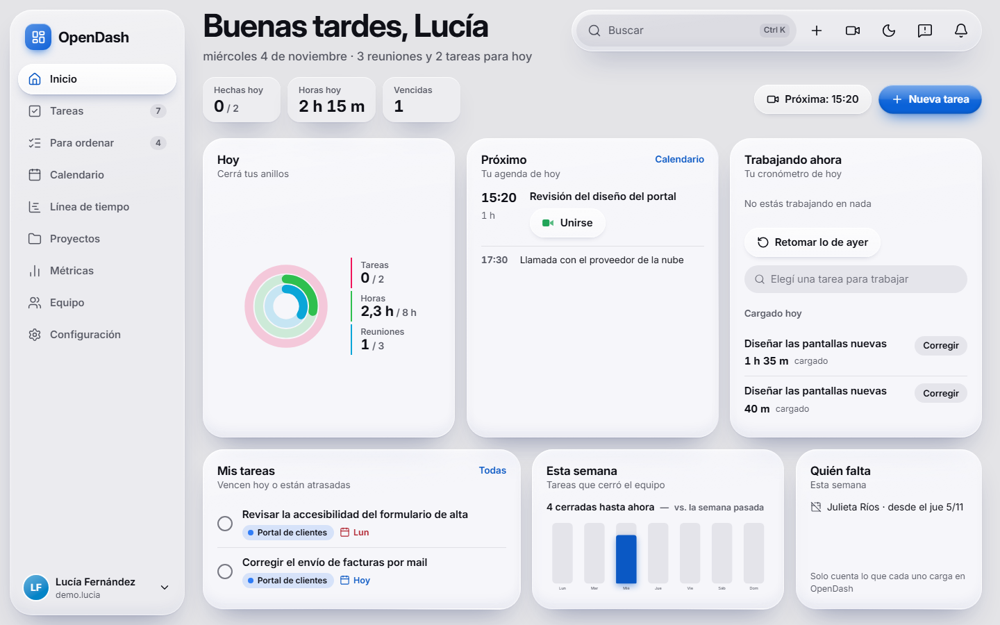

# OpenDash

Capa visual sobre [OpenProject](https://www.openproject.org/): el equipo trabaja desde OpenDash y los datos siguen viviendo en OpenProject. Tablero, línea de tiempo con dependencias, calendario, métricas, carga del equipo y un cronómetro que carga las horas en OpenProject, todo en una sola app web.

Es un único proceso de Node que sirve la API y la web, con SQLite para lo propio (usuarios, sesiones, caché, ajustes). El navegador nunca habla con OpenProject: todo pasa por el servidor, que actúa con el token de API de cada persona (guardado cifrado, nunca enviado al navegador). No hace falta ser administrador de OpenProject ni de Microsoft 365.

La interfaz está en castellano rioplatense y las fechas van en la zona de Buenos Aires.



## Qué tiene

- **Inicio**: lo que vence hoy y lo atrasado, la semana del equipo, quién falta, la próxima reunión y el cronómetro.
- **Tareas**: tablero de cuatro columnas (Nuevo, En curso, En pausa y Cerrado), lista y detalle con comentarios, dependencias, subtareas, adjuntos y pausas.
- **Línea de tiempo**: reemplaza el Gantt de OpenProject. Barras por proyecto o por persona, dependencias dibujadas, arrastrar para mover o estirar, correr las sucesoras en cascada con «Deshacer», y feriados y vacaciones marcados.
- **Proyectos**: avance, próximo hito y cierre de cada proyecto; crear proyectos vacíos o desde una plantilla, con miembros y versiones, sin entrar a OpenProject.
- **Calendario**: las reuniones de cada persona, leídas del enlace ICS que publica desde Outlook web, más los feriados nacionales y las vacaciones.
- **Horas de trabajo**: ▶ en una tarea y el tiempo se carga en OpenProject como entrada de tiempo al terminar. Puede haber varias tareas a la vez, tiene un tope diario configurable (con horas extra si se confirma), «Retomar lo de ayer» y pide el estimado cuando falta.
- **Métricas**: ritmo de cierres, reparto por proyecto, trabajado contra estimado y carga del equipo, con descarga a Excel.
- **Equipo**: presencia, carga contra capacidad semanal y en qué trabaja cada uno.
- **Para ordenar**: lo que necesita atención en un solo lugar: fechas que se pisan, vencidas, sin fechas, sin asignar y personas con más trabajo del que entra.
- **Avisar un problema**: cualquiera manda un aviso con captura y quien administra lo ve en «Problemas avisados».
- Aviso antes de cada reunión, tema claro u oscuro, búsqueda con `Ctrl K` y app instalable.

## Capturas

Con datos de una demo inventada.

| | |
|---|---|
|  |  |
| **Tareas**: tablero con filtros por proyecto, persona y prioridad. | **Línea de tiempo**: barras por proyecto, dependencias, feriados y horas trabajadas contra estimadas. |
|  |  |
| **Calendario**: reuniones de Outlook, vencimientos y feriados; el panel del día con «Unirse». | **Equipo**: quién está conectado, en qué trabaja y su carga contra la capacidad semanal. |
|  |  |
| **Proyectos**: avance, próximo hito y miembros de cada proyecto. | **Tema claro**: todas las pantallas tienen tema claro y oscuro. |

## Requisitos

- Node 22 o más nuevo.
- Un OpenProject (probado con la versión 16) al que llegue el servidor de OpenDash, y un token de API por persona.
- Para el calendario y los feriados, salida HTTPS a `outlook.office365.com`, `outlook.office.com`, `outlook.live.com` y `api.argentinadatos.com`. Sin eso se puede usar igual: el calendario no se actualiza y los feriados se cargan a mano en Configuración.

## Instalación

```bash
git clone https://github.com/romassardo/opendash-openproject.git
cd opendash-openproject
npm ci --ignore-scripts
cp .env.example .env        # en PowerShell: Copy-Item .env.example .env
node -e "console.log(require('crypto').randomBytes(32).toString('base64'))"
```

`--ignore-scripts` evita que npm intente compilar `better-sqlite3`: el paquete ya trae el binario para Windows, Linux y macOS (x64 y arm64). Sin la opción, npm llama a `node-gyp`, que falla en una PC sin herramientas de compilación.

Pegá la clave generada en `OPENDASH_CLAVE_CIFRADO` dentro de `.env` y poné la dirección de tu OpenProject en `OPENPROJECT_URL`. Con esa clave se cifran los tokens guardados en SQLite: si la perdés o la cambiás, cada persona tiene que volver a cargar el suyo.

| Variable | Qué es | Por defecto |
|---|---|---|
| `OPENPROJECT_URL` | URL de OpenProject | (obligatoria) |
| `OPENDASH_CLAVE_CIFRADO` | 32 bytes en base64 | (obligatoria) |
| `OPENDASH_PUERTO` | puerto de OpenDash | `5174` |
| `OPENDASH_HOST` | interfaz donde escucha (`0.0.0.0` = toda la red) | `0.0.0.0` |
| `OPENDASH_DB` | archivo SQLite | `./datos/opendash.db` |
| `OPENDASH_FERIADOS_URL` | de dónde se leen los feriados | ArgentinaDatos |

## Compilar y arrancar

```bash
npm run build
npm start
```

`npm start` lee el `.env`, arranca en modo producción y sirve la API y la web. Al arrancar muestra las direcciones para entrar (`http://localhost:5174` y las de la PC en la red). Para dejarlo siempre encendido, usá PM2, un servicio de systemd o el Programador de tareas de Windows.

Conviene servirlo por HTTPS (detrás de nginx, Caddy o similar): la pregunta de inactividad del cronómetro, los avisos de reunión desde otra pestaña y la app instalable solo andan en un contexto seguro. Sin HTTPS funciona todo lo demás.

En Linux se instala igual. En el servidor alcanza con `package.json`, `package-lock.json`, `dist/` y el `.env`:

```bash
npm ci --omit=dev --ignore-scripts
npm start
```

## Primer ingreso

Cada persona entra con su propio token de OpenProject: avatar → Mi cuenta → Tokens de acceso → API → Generar. Se copia en el momento (después no se vuelve a mostrar) y se pega en «Primera vez» en la pantalla de ingreso de OpenDash, donde además elige su contraseña.

Desde Configuración se ajusta qué estado de OpenProject corresponde a cada columna del tablero, la jornada diaria de las horas, el tono e ícono de cada proyecto, los feriados y el enlace del calendario de Outlook de cada uno.

### Que el equipo entre a una PC con Windows

Si OpenDash corre en una PC con Windows, en un PowerShell **como administrador**:

```powershell
powershell -ExecutionPolicy Bypass -File scripts\abrir-firewall.ps1
```

Crea la regla «OpenDash» (TCP 5174 entrante, redes privadas y de dominio) y muestra las direcciones para pasarle al equipo. Si la primera vez Windows pregunta si permitís que «Node.js JavaScript Runtime» se comunique en la red, elegí **Permitir acceso**: si tocás **Cancelar**, Windows crea una regla que bloquea `node.exe` y le gana a la de OpenDash.

## Desarrollo

```bash
npm run dev          # servidor (tsx watch) + Vite; la web queda en http://localhost:5173
npm test             # pruebas unitarias y de componentes (Vitest, no necesitan OpenProject)
npm run typecheck    # TypeScript
```

Las pruebas de integración y E2E usan un OpenProject de prueba en Docker en `http://localhost:8090`; nunca escriben en otro. Primero se levanta y se siembra (la primera vez tarda varios minutos):

```bash
docker compose -f docker-compose.prueba.yml up -d
npx tsx scripts/preparar-op-prueba.ts
npm run test:integracion
npm run test:e2e     # Playwright con Chrome; compila y arranca el servidor solo
```

Hecho con React, Vite, TypeScript, Fastify, SQLite (`better-sqlite3`), GSAP para las animaciones y gráficos en SVG dibujados a mano.

## Licencia

[MIT](LICENSE).
